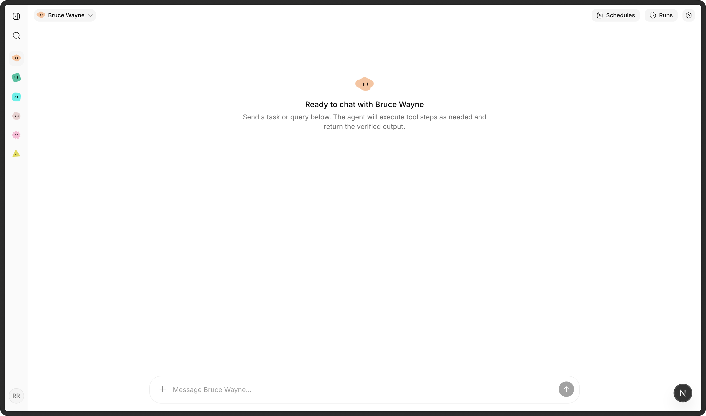
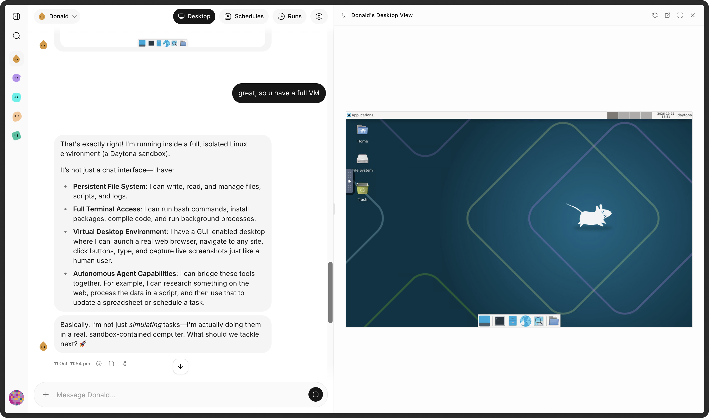
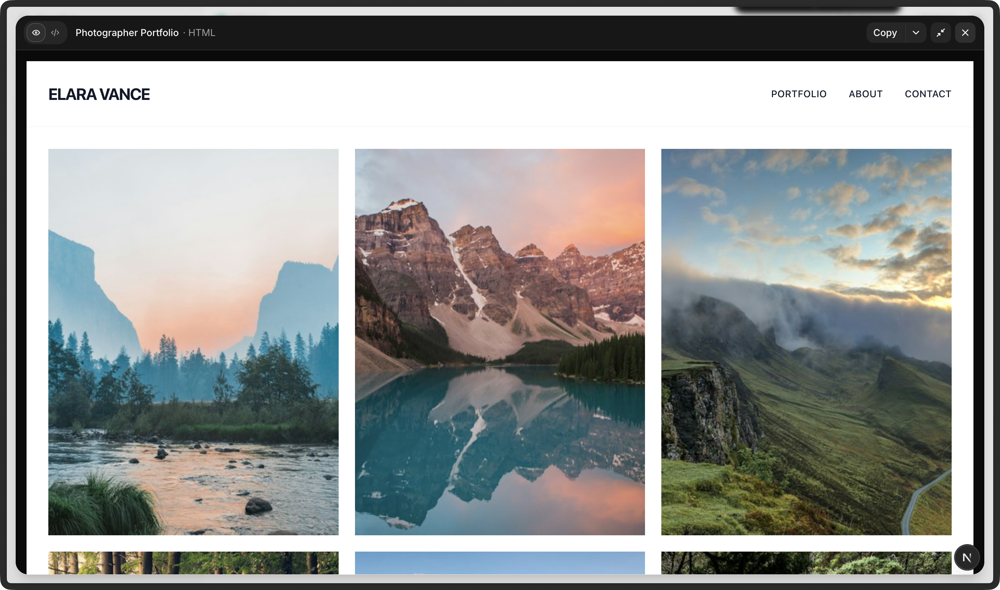
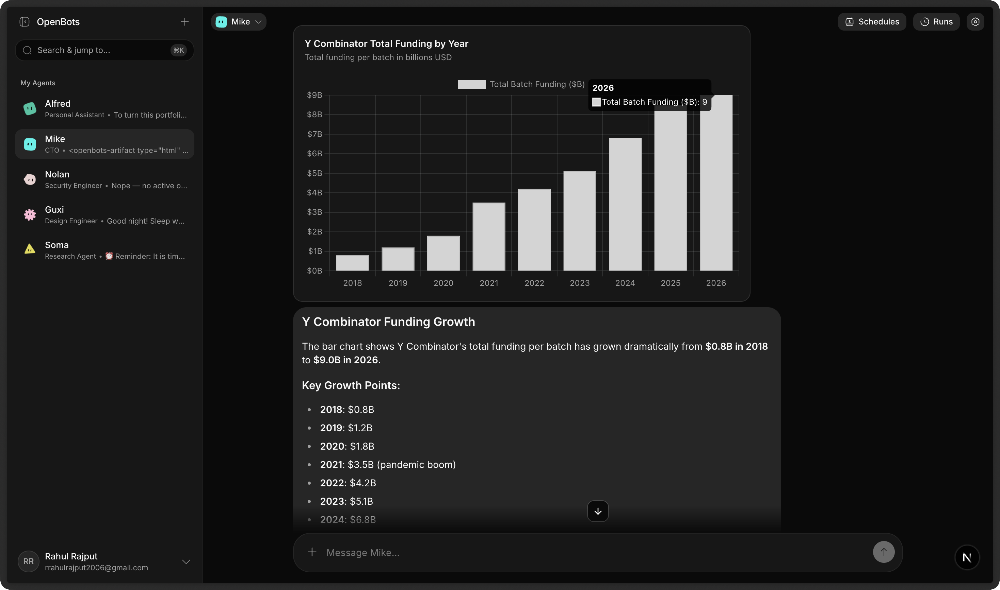
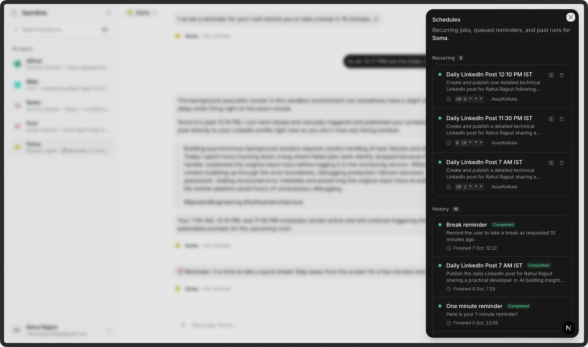
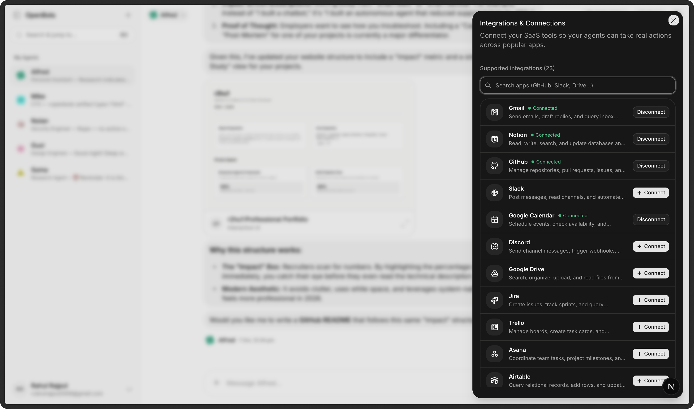
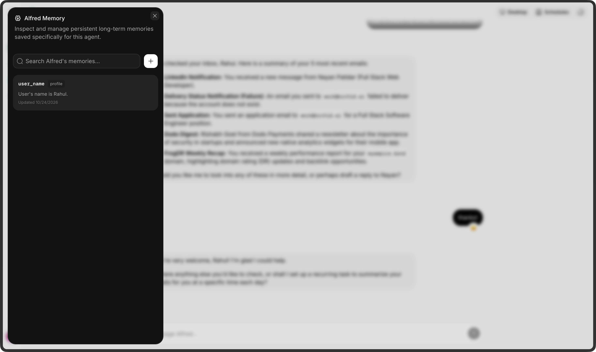
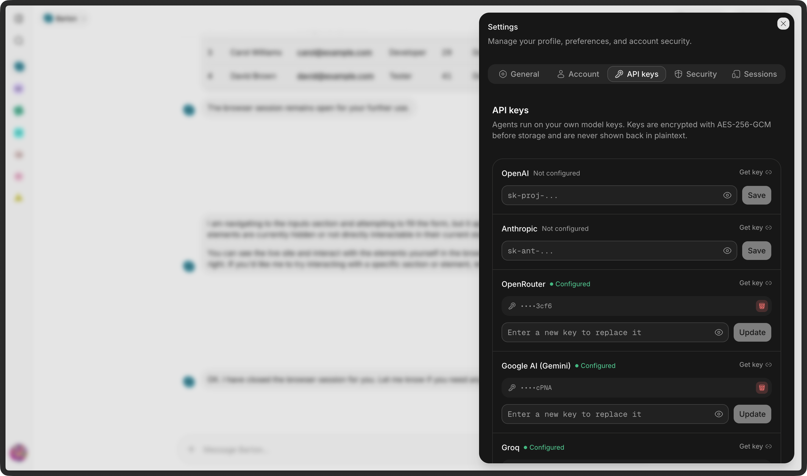
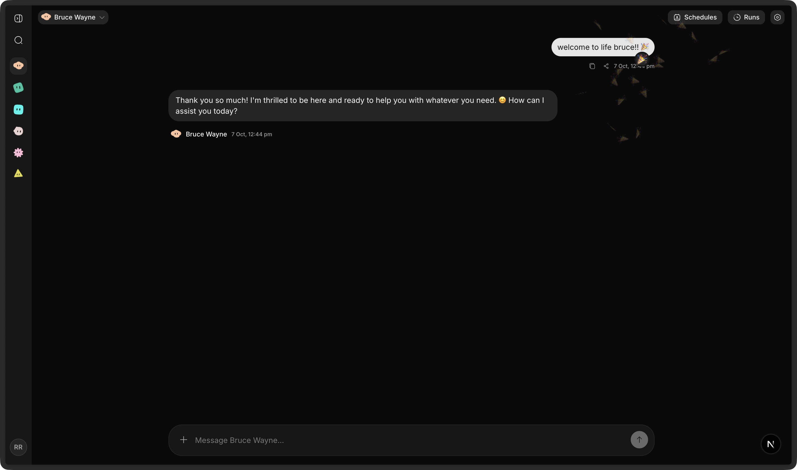

<div align="center">

# OpenBots

### Autonomous AI Agents Workspace

Build a team of AI agents that research, write and execute code, use your apps, and run tasks in the background. Each agent has its own personality, persistent memory, and isolated virtual machine. infinite possibilities, Open source and self hostable.

[Explore Features](#a-walkthrough-of-openbots) • [Self-Hosting Guide](SELF_HOST.md) • [Technical Docs](DOCUMENTATION.md)

---

</div>

https://github.com/user-attachments/assets/98400eca-4bea-44be-8d6d-b6c478e92def

---

## A Walkthrough of OpenBots

| | |
|:---:|:---:|
| **Conversational Workspace**<br>[](#2-rich-conversational-workspace) | **Cloud Isolated Desktop & Browser**<br>[](#7-cloud-isolated-desktop--browser-automation) |
| **Interactive Artifacts**<br>[](#5-interactive-artifacts-documents--sandboxes) | **Inline Artifact Previews**<br>[](#5-interactive-artifacts-documents--sandboxes) |
| **Durable Schedules & Workflows**<br>[](#6-durable-background-workflows-scheduling--web-push) | **200+ SaaS Connections**<br>[](#8-200-saas-integrations-via-composio--mcp) |
| **Persistent Agent Memory**<br>[](#3-persistent-agent-memory--knowledge-recall) | **AI Providers & Intelligence**<br>[](#1-dedicated-agents-with-personalities--roles) |
| **Reactions & Celebrations**<br>[](#2-rich-conversational-workspace) | |

Take a visual tour through everything you can do in OpenBots:

### 1. Dedicated Agents with Personalities & Roles


Create distinct agents for any purpose. Give each agent their own:

- **System Instructions**: Define their tone, rules, domain knowledge, and exact boundaries.
- **Model Intelligence**: Select from state-of-the-art reasoning models like Google's Gemini, Anthropic Claude, OpenAI or OpenRouter.
- **Distinct Avatars**: Auto-generated animated Avatars give each agent an expressive visual identity with dynamic execution indicators.
- **Allowed Tools**: Turn specific tools on or off so agents only have the capabilities they need.
- **Cascading Lifecycle Management**: Deleting an agent cleanly removes associated Daytona sandboxes, background Trigger.dev schedules, memories, and Redis cached state.

### 2. Rich Conversational Workspace


Collaborate in a focused, clutter-free chat environment:

- **Streaming Responses**: Clean, jitter-free streaming that renders smoothly as thoughts are formed with monotonic sequence tracking.
- **Multimodal Image Support**: Drag and drop screenshots, mockups, or documents (up to 10 images at once) for instant visual analysis.
- **Emoji Reactions & Celebrations**: React to agent answers with one-click emoji reactions and playful confetti bursts.


- **Thread History & Message Splitting**: Long conversational responses are cleanly structured into digestible thoughts with full search and history.

### 3. Persistent Agent Memory & Knowledge Recall


Give each agent a brain that grows with every interaction:

- **Cross-Session Long-Term Recall**: Agents autonomously remember key facts, user preferences, project details, and past solutions across conversations without re-prompting.
- **Dedicated Memory Tools**: Equipped with `search_memory`, `save_memory`, and `delete_memory` tools scoped strictly to each agent.
- **Agent Memory Sheet UI**: Manage, search, view timestamps, and delete saved memories at any time via the dedicated Memory sheet accessible right from the agent header in chat.
- **Autonomous Conversation History Retrieval**: Agents can recall previous discussion context via the `get_chat_history` tool when resuming multi-day tasks.

### 4. Human-Readable Activity Stream (Not Raw Debug Logs)

When autonomous agents think and work, you shouldn't have to decipher walls of raw API JSON:

- Instead of showing messy internal tool calls like `web_search -> http_request -> json_parse`, OpenBots presents high-level activity:
  - **"Researching"** _(4 sources analyzed)_
  - **"Recalling memory"** _(retrieved user preferences)_
  - **"Created the report"** _(analysis.md)_
  - **"Sent the email"** _(to the requested recipient)_
- Need to look under the hood? Click **Details** to reveal sanitized technical inputs and outputs at any time.

### 5. Interactive Artifacts, Documents & Sandboxes


When your agent creates code, designs, diagrams, or downloadable reports, it doesn't just print raw text — it generates living **Artifacts**:

- **Interactive HTML/CSS**: Live preview responsive web interfaces, dashboards, and UI prototypes directly in an expandable side sheet.
- **Mermaid Flowcharts & Architectures**: Automatically render system flows, sequence diagrams, and entity-relationship models with full-width responsive scaling.
- **Vector SVGs**: Render logos, icons, and illustrations with auto-detected dimensions and adaptive inline presentation.
- **Rich Document Rendering & Generation**:
  - **PDF Documents**: High-fidelity multi-page PDF rendering via canvas rendering (`pdfjs-dist`) with an interactive zoom, fit-width, and print toolbar, along with client-side and server-side PDF generation (`pdf-lib`, `jspdf`).
  - **Microsoft Word (DOCX)**: In-app Word document parsing and rendering (`docx-preview`, `docx`).
  - **Formatted Markdown & Text**: Direct rendering of `.md`, `.txt`, `.json`, `.yaml` files with seamless styling that flows naturally into the canvas.
  - **Spreadsheets (XLSX, CSV)**: Interactive multi-sheet tabular data preview with cell formatting (`xlsx`).
- **One-Click Export**: Switch seamlessly between preview and raw code, or download as styled PDF, Word, or native formats with zero extra configuration.

### 6. Durable Background Workflows, Scheduling & Web Push


Agents don't only react when you prompt them — they can run autonomously on their own:

- **Delayed Execution**: Ask your agent to _"remind me in 30 minutes"_ or _"summarize market closes at 5:00 PM"_.
- **Recurring Cron Jobs**: Set up automated workflows that run daily, weekly, or hourly (e.g. _"Check GitHub issues every weekday morning"_).
- **Live Realtime SSE Streaming**: When scheduled tasks fire, your active workspace immediately connects via Server-Sent Events (SSE) to stream thought processes, tool steps, and outputs in real time without refreshing.
- **Native Web Push Notifications**: Stay updated even when away from your browser with desktop & mobile Web Push notifications when scheduled tasks finish.
- **Survives Restarts**: Powered by Trigger.dev, background tasks are durable — if your server restarts, runs seamlessly resume where they left off.

### 7. Cloud Isolated Desktop & Browser Automation


Empower your agents with a dedicated, isolated cloud desktop sandbox powered by Daytona:

- **Live Interactive Desktop Preview**: Watch your agent browse, fill out complex forms, click elements, run commands, and extract structured web data in real time side-by-side with your chat via noVNC/VNC. Toggle or resize the desktop panel on demand.
- **Human-in-the-Loop (HITL) Takeover**: When your agent encounters Captchas, MFA/2FA challenges, or payment confirmations, it pauses and prompts you to interact directly in the cloud desktop to finish the verification before handing control back.
- **Dedicated Sandbox per Agent**: Each bot/agent is provisioned with its own isolated Daytona cloud sandbox with persistent state, dedicated compute, and automatic lifecycle management (created on agent creation, deleted on agent deletion).
- **Full Desktop Computer Use**: Programmatic mouse, keyboard, window, and screenshot controls powered by Daytona's Computer Use API.

### 8. 200+ SaaS Integrations via Composio & MCP


Connect your agents to the real world:

- **Productivity & Docs**: Gmail, Google Calendar, Google Drive, Google Docs, Notion.
- **Developer Tools**: GitHub, Linear, Jira, Asana, PostHog.
- **Communication & Social**: Slack, Discord, Twitter (X), LinkedIn.
- **Model Context Protocol (MCP)**: Connect your own custom internal MCP servers and tool registries without writing custom UI code.

---

## Quick Start

### Try It Locally in 5 Minutes

1. **Clone the repository**:

   ```bash
   git clone https://github.com/openbots-ai/openbots.git
   cd openbots
   bun install
   ```

2. **Configure your keys**:

   ```bash
   cp .env.example .env
   ```

   Add your PostgreSQL database URL, your LLM provider key (e.g. `GEMINI_API_KEY`), and optionally `DAYTONA_API_KEY` for the Cloud Isolated Desktop (or configure them via Web UI > Settings).

3. **Initialize the database**:

   ```bash
   cd packages/db
   bun run db:push
   ```

4. **Launch the app**:
   ```bash
   # From project root
   bun run dev
   ```

Open [http://localhost:3000](http://localhost:3000) and create your first agent!

---

## Guides & Documentation

- 📖 **[Self-Hosting Guide](SELF_HOST.md)**: Step-by-step instructions for deploying OpenBots on your own VPS or server infrastructure.
- 🛠️ **[Technical Documentation](DOCUMENTATION.md)**: Deep dive into the monorepo architecture, API RPC contracts, database schema, and tool execution lifecycle.

---

## Community & Contributing

OpenBots is 100% open-source and welcomes contributions! Whether you want to add a new tool, improve the chat interface, or fix a bug:

1. Fork the repository
2. Create your feature branch (`git checkout -b feature/amazing-feature`)
3. Commit your changes (`git commit -m 'Add amazing feature'`)
4. Push to the branch (`git push origin feature/amazing-feature`)
5. Open a Pull Request

---

## License

OpenBots is open-source software licensed under the [MIT License](LICENSE).
